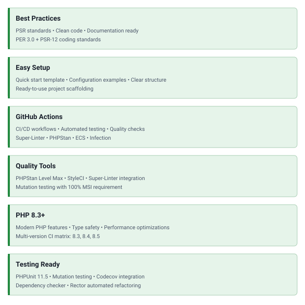

<!-- markdownlint-disable MD041 -->
<p align="center">
    <picture>
        <source media="(prefers-color-scheme: dark)" srcset="https://www.yiiframework.com/image/design/logo/yii3_full_for_dark.svg">
        <source media="(prefers-color-scheme: light)" srcset="https://www.yiiframework.com/image/design/logo/yii3_full_for_light.svg">
        
    </picture>
    <h1 align="center">Template</h1>
    <br>
</p>
<!-- markdownlint-enable MD041 -->

<p align="center">
    <a href="https://github.com/yii2-extensions/template/actions/workflows/build.yml" target="_blank">
        
    </a>
    <a href="https://dashboard.stryker-mutator.io/reports/github.com/yii2-extensions/template/main" target="_blank">
        
    </a>
    <a href="https://github.com/yii2-extensions/template/actions/workflows/static.yml" target="_blank">
        
    </a>
    <a href="https://github.com/yii2-extensions/template/actions/workflows/security.yml" target="_blank">
        
    </a>
</p>

<p align="center">
    <strong>A Yii2 extension template to create your own Yii2 extensions</strong><br>
    <em>PHPUnit, PHPStan, Infection, ECS, and GitHub Actions ready out of the box</em>
</p>

## Features

<picture>
    <source media="(min-width: 768px)" srcset="./docs/svgs/features.svg">
    
</picture>

## Quick start

### Installation

```bash
composer require github_username/github_repository-name "yiisoft/yii2:^22.0@dev"
```

### Basic usage

Describe how to use your extension in a basic way.

```php
use yii\template\Example;

$example = new Example();

$legacy = $example->getExample(true);
```

## Documentation

- 📚 [Installation guide](docs/installation.md)
- ⚙️ [Configuration guide](docs/configuration.md)
- 💡 [Usage examples](docs/examples.md)
- 🧪 [Testing guide](docs/testing.md)

The guides and the [API reference](https://yii2-framework.github.io/docs/extensions/template/reference/) generated from
the PHPDoc in `src/` are published at <https://yii2-framework.github.io/docs/extensions/template/>.

## AI assistance

AI agents: read the [documentation index](https://yii2-framework.github.io/docs/llms.txt) and fetch the Markdown version
of a page by appending `index.md` to its URL. The
[AI agents guide](https://yii2-framework.github.io/docs/project/ai-agents/) covers skill installation, client setup and
verification.

- 🧭 [`yii2-framework` skill](https://yii2-framework.github.io/docs/guide/skills/yii2-framework/): Yii 22.0 application
  conventions.

The hosted documentation covers Yii 22.0. If it does not match the installed revision or is unavailable, use the
[repository guides](#documentation), the source PHPDoc and the [changelog](CHANGELOG.md).

## Package information

[](https://www.php.net/releases/8.3/en.php)
[](https://github.com/yiisoft/yii2/tree/22.0)

## Project status

[](https://codecov.io/github/yii2-extensions/template)
[](https://github.com/yii2-extensions/template/actions/workflows/static.yml)
[](https://github.com/yii2-extensions/template/actions/workflows/quality.yml)
[](https://github.styleci.io/repos/698621511?branch=main)

## Our social networks

[](https://x.com/Terabytesoftw)
[](https://www.facebook.com/wilmer.arambula.9)
[](https://www.reddit.com/r/Yii2/)
[](https://t.me/yii_framework_in_english)

## License

[](LICENSE)
